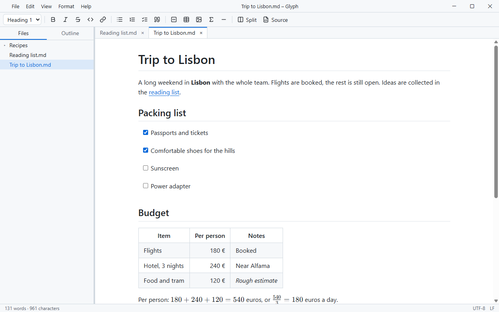
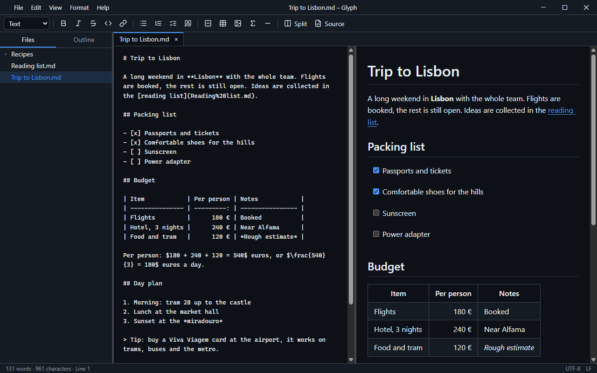
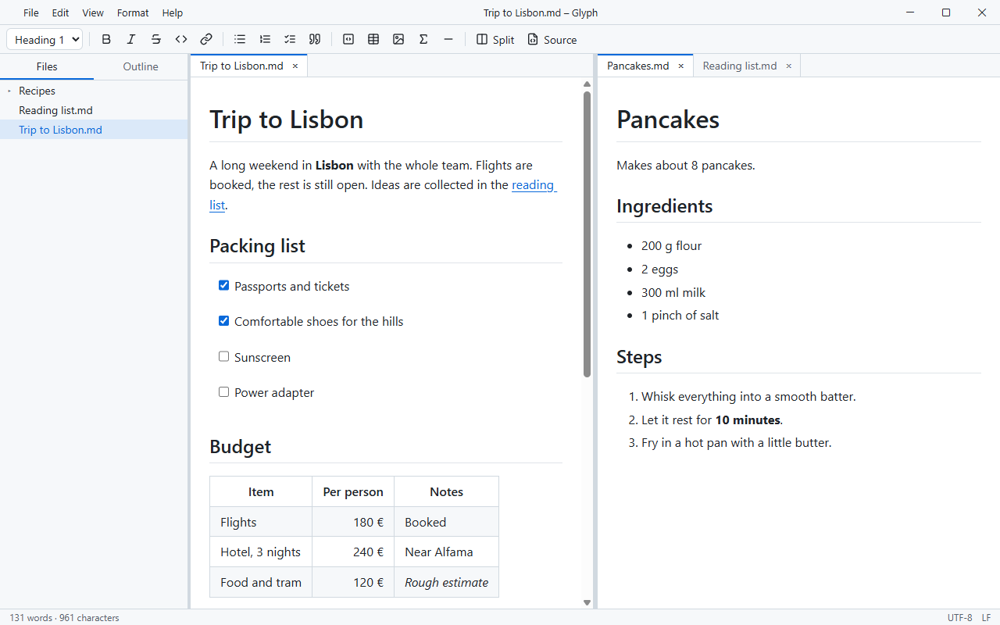

# Glyph

Glyph is a desktop Markdown editor for Windows by ChillCode. You write in a single live view: a heading grows as you type `#`, `**bold**` turns bold, and the Markdown syntax steps back once the cursor leaves the element. There is no separate preview pane to keep an eye on, yet the file on disk stays plain Markdown, and Glyph writes it back exactly as it found it unless you changed something.

## Why Glyph

- **Write, don't preview.** Headings, lists, task lists, GFM tables, syntax-highlighted code blocks, images and LaTeX formulas render in place while you type.
- **Your files stay yours.** An unchanged document is saved byte for byte; after an edit only the changed blocks are rewritten. Encoding, BOM and line endings are kept.
- **Room to work.** Tabs, a second pane, a Source + Live view, a folder tree and a document outline.
- **Made for daily use.** Light, dark or system theme; German, English and Arabic interface; export to standalone HTML and to PDF; crash recovery and session restore.

| Source + Live view (dark theme)                                       | Two panes side by side                                    |
| --------------------------------------------------------------------- | --------------------------------------------------------- |
|  |  |

## Download

Get the latest installer from the **[Releases page](https://github.com/ChillCodeForge/Glyph/releases/latest)**. Download `Glyph_<version>_x64-setup.exe` and run it; it installs per user and needs no admin rights. Each release lists what changed and the SHA-256 checksum of the installer in `SHA256SUMS.txt`. The installer is not code-signed, so Windows SmartScreen may warn on first run.

## Source code

Glyph is closed source. This repository only publishes release binaries; it contains no source code and does not accept pull requests.

## Reporting problems

Found a bug or have a suggestion? Open an [issue](https://github.com/ChillCodeForge/Glyph/issues). Please include the Glyph version (part of the installer file name), your Windows version, and the steps that lead to the problem.

Copyright © ChillCode. All rights reserved.
